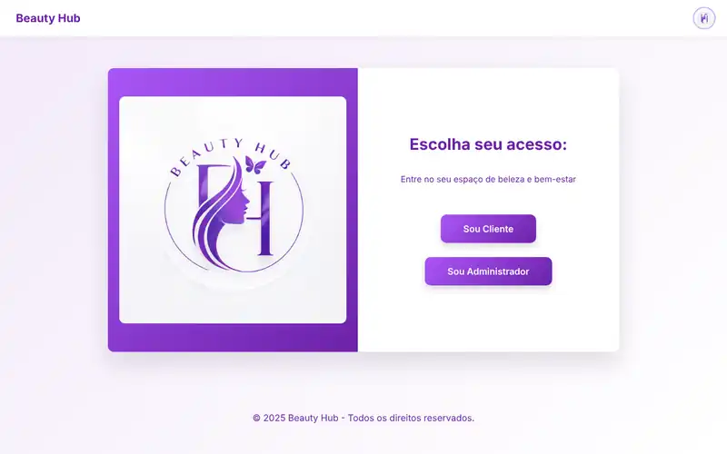
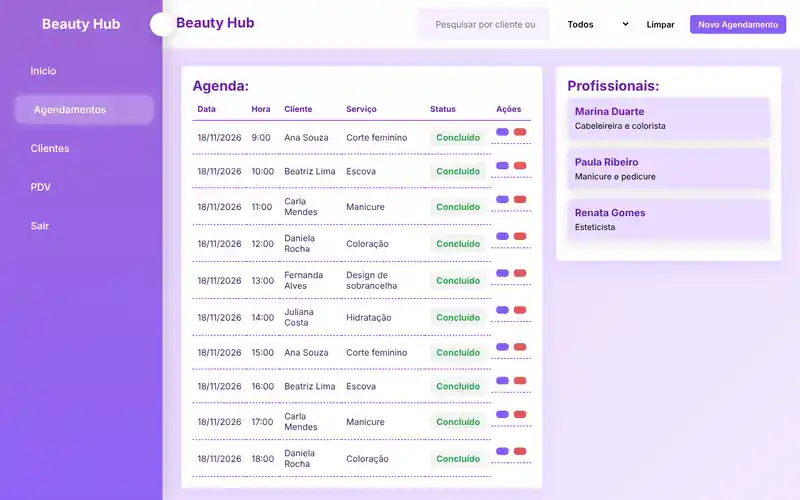

# Beauty Hub

Sistema web de agendamento para salões de beleza, com **área do cliente** (cadastro, agendamento e histórico) e **área administrativa** (agenda, profissionais, serviços, clientes e ponto de venda). API REST em Node.js com MySQL, empacotada com Docker Compose.


## Telas

> Imagens geradas com dados de exemplo.

| Escolha de acesso | Agendamento (cliente) |
| --- | --- |
|  |  |

**Agenda do salão (administrador)**



## Funcionalidades

**Área do cliente**
- Cadastro e login
- Escolha do profissional e do serviço, com verificação dos horários disponíveis
- Histórico de agendamentos, com opção de cancelar
- Edição do perfil

**Área administrativa**
- Dashboard com estatísticas do salão
- Agenda do dia com busca e filtro por status
- Gestão de profissionais e dos serviços de cada um
- Lista de clientes
- Ponto de venda (PDV)
- Faturamento por mês

## Tecnologias

| Camada | Tecnologia |
| --- | --- |
| Front-end | HTML, CSS e JavaScript puro |
| Back-end | Node.js, Express |
| Banco de dados | MySQL 8 (`mysql2` com pool de conexões) |
| Autenticação | JWT e senhas com hash `bcrypt` |
| Infraestrutura | Docker e Docker Compose |

## Arquitetura

```
Navegador (HTML/CSS/JS)
        │  fetch /api/...
        ▼
Express (backend/server.js)
  ├── middleware/auth.js      verificação do token JWT
  └── routes/                 auth, appointments, professionals,
                              services, clients, admin
        │
        ▼
MySQL 8 (container "db" no Docker Compose)
```

```
beauty-hub/
├── docker-compose.yml        sobe o MySQL e a API
└── Beauty-Hub-master/
    ├── backend/
    │   ├── server.js         configuração do Express e das rotas
    │   ├── database/         pool de conexões MySQL
    │   ├── middleware/       autenticação
    │   └── routes/           rotas da API REST
    └── public/               páginas, estilos e scripts do front-end
```

A lista completa de endpoints está em [`Beauty-Hub-master/backend/README.md`](Beauty-Hub-master/backend/README.md).

## Como executar

### Com Docker (recomendado)

**Pré-requisito:** Docker com Docker Compose.

```bash
git clone https://github.com/shandriasarah/beauty-hub.git
cd beauty-hub
docker compose up --build
```

Isso sobe dois containers: o MySQL 8 (porta `3306`, banco `beauty_hub`) e a API (porta `3000`).

### Sem Docker

**Pré-requisitos:** Node.js 18+ e MySQL 8.

```bash
cd beauty-hub/Beauty-Hub-master/backend
npm install
```

Crie um arquivo `.env` nessa pasta:

```env
DB_HOST=localhost
DB_USER=root
DB_PASSWORD=sua_senha
DB_NAME=beauty_hub
JWT_SECRET=uma_chave_secreta
```

```bash
npm start
```

Depois abra as páginas de `Beauty-Hub-master/public/` no navegador.

## Autora

Desenvolvido por **Sarah Shandria**, estudante de Ciência da Computação.

[LinkedIn](https://www.linkedin.com/in/sarah-shandria-727b86376/) · [GitHub](https://github.com/shandriasarah)
